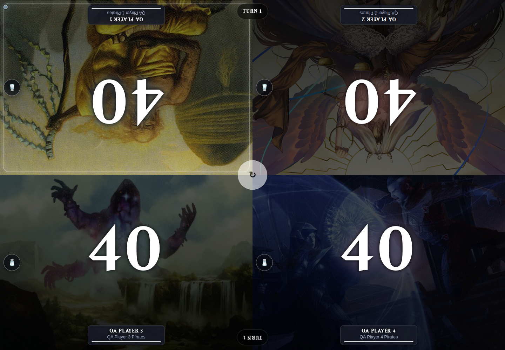

Advanced browsing and shared UI polish was deployed to stable on 2026-10-22 at 16:13 Europe/Berlin (14:13 UTC).

Decks, Players, and Games now share explicit GET-based Apply controls, search, deterministic sorting, 10/25/50/100 pagination, removable filter chips, clear actions, inline validation, and distinct empty states. Summaries describe the complete filtered result set. Deck and player statistics support Lifetime, Last 30 days, Last 90 days, and Custom dates. Recovered undated history is included only in Lifetime; MMR stays current. Custom dates use inclusive UTC calendar boundaries. Inactive custom date inputs are omitted when applying a preset, and contradictory URLs produce an inline error.

Deck filtering covers owner, status, color matching, declared bracket, cached strategies/mechanics, decklist presence, tag freshness, and numeric statistics. Player filtering covers account type, activity, games, wins, win rate, all owned decks, and current average MMR. Game filtering covers notes/participants/decks/commanders, existing participant/winner/date/count filters, win type, timed mode, ending turn, and duration in minutes. Multiple values in bracket, strategy, mechanic, and win-type groups use OR; different groups use AND.

Legacy owner and `show_retired=1` URLs remain supported. Listing state survives pagination, game scope changes, detail/editor navigation, and return links. Return destinations are restricted to local listing routes. Player comparison now uses the existing session-storage controller across filtering and pagination. Shared styles improve form labels, focus, contrast, touch targets, navigation wrapping, and mobile spacing. Live-game, player-panel, and setup geometry is excluded from the shared polish stylesheet. Existing deferred detail artwork and uncommitted performance/tag-banner work were retained.

Verification completed:

- Full suite: **402 passed, 189 subtests passed**. The sole warning is the expected temporary test-process Flask secret warning. Tests use isolated databases and `/tmp/commander-test-art`; no production fixtures were created or removed.
- Added browsing coverage includes all sort choices, individual and combined filters, UTC boundary microseconds, 30/90-day boundaries, borrowed decks, historical totals, retired/planned decks, missing numeric/color metadata, invalid/empty query parameters, authorized filter choices, legacy links, stable pagination, full-set summaries, and bounded query counts.
- Playwright checked **42 layouts**: three listings, player/deck details, editor, and profile at 1440, 375, and 320 pixels, in both themes. No horizontal overflow or page JavaScript errors were observed.
- Browser interaction checks covered explicit Apply and Enter, chip removal, clearing, pagination, detail return links, native Back scroll restoration, game scope preservation, comparison persistence, keyboard disclosure, mobile menu/Escape, reduced motion, custom-to-preset switching, inline errors, and login at 320 pixels.
- The QA app bound to `0.0.0.0:5055`; Chromium reached it at `http://localhost:5055`. Four clearly marked QA players were created through the Players UI. Each imported the canonical Archidekt list through the editor; all imports returned 100 cards. Each also received an alternate deck in the isolated fixture database. Setup started a running game with four distinct player/deck assignments, all initialized to 40 life.
- Scryfall rate-limited optional editor artwork requests during initial seeding. Subsequent visual checks disabled optional Scryfall lookups only in the temporary QA server and used copied local artwork. Archidekt imports used the real importer. These QA overrides were outside the repository and are absent from the deployed image.

Representative response-time comparison used equivalent isolated SQLite fixtures with 80 players, 160 decks, and 240 four-player games. Values are the median of five warm requests after one warmup. Default Decks/Players now return 25 items; the previous implementation returned every item. Queries remain bounded as fixtures grow.

| Listing | Before | After | Queries before → after |
| --- | ---: | ---: | ---: |
| Decks | 18.77 ms | 10.18 ms | 8 → 11 |
| Players | 9.26 ms | 9.47 ms | 12 → 13 |
| Games | 18.98 ms | 20.51 ms | 17 → 17 |
| Decks, games/color filters | 18.53 ms | 9.93 ms | 8 → 11 |
| Players, games filter | 9.20 ms | 9.63 ms | 12 → 13 |
| Games, count/duration filters | 20.18 ms | 21.86 ms | 17 → 17 |

The new filter parameters in the last three rows were ignored by the old implementation where unsupported, so those rows measure response overhead rather than equivalent filtering behavior. These local timings are not a production load test.

Stable rollout used `docker compose build commander-tracker` and `docker compose up -d --no-deps commander-tracker`. The final image is `sha256:7b6dac638512657b77bc91ce18720c54e5b0c2b9761d58718ac9ae236498c56f`. Health and database reachability passed. Anonymous listing requests redirect to login. Authenticated admin and member HTTP requests passed representative filters and invalid-query handling. SHA-256 hashes for all 17 checked source/template/style files match the workspace. Startup logs contain normal Gunicorn startup messages and no errors. The test Compose service retained its previous startup time. No commit, push, database migration, or saved-filter model was introduced.

Screenshot examples (additional theme/width variants are in `advanced-browsing/`):

| View | Desktop | Mobile |
| --- | --- | --- |
| Decks | [Dark](advanced-browsing/decks-dark-1440.png) · [Light](advanced-browsing/decks-light-1440.png) | [375px](advanced-browsing/decks-dark-375.png) · [320px](advanced-browsing/decks-light-320.png) |
| Players | [Dark](advanced-browsing/players-dark-1440.png) · [Light](advanced-browsing/players-light-1440.png) | [375px](advanced-browsing/players-dark-375.png) · [320px](advanced-browsing/players-light-320.png) |
| Games | [Dark](advanced-browsing/games-dark-1440.png) · [Light](advanced-browsing/games-light-1440.png) | [375px](advanced-browsing/games-dark-375.png) · [320px](advanced-browsing/games-light-320.png) |
| Deck detail | [Dark](advanced-browsing/deck-detail-dark-1440.png) | [Light](advanced-browsing/deck-detail-light-375.png) |
| Player detail | [Dark](advanced-browsing/player-detail-dark-1440.png) | [Light](advanced-browsing/player-detail-light-375.png) |
| Editor | [Dark](advanced-browsing/editor-dark-1440.png) | [Light](advanced-browsing/editor-light-375.png) |
| Profile | [Dark](advanced-browsing/profile-dark-1440.png) | [Light](advanced-browsing/profile-light-375.png) |

[Advanced filters](advanced-browsing/advanced-filters-light.png) · [Empty state](advanced-browsing/empty-light-375.png) · [Inline validation](advanced-browsing/validation-light-375.png) · [Period preset](advanced-browsing/period-preset-375.png) · [Login](advanced-browsing/login-320.png)

