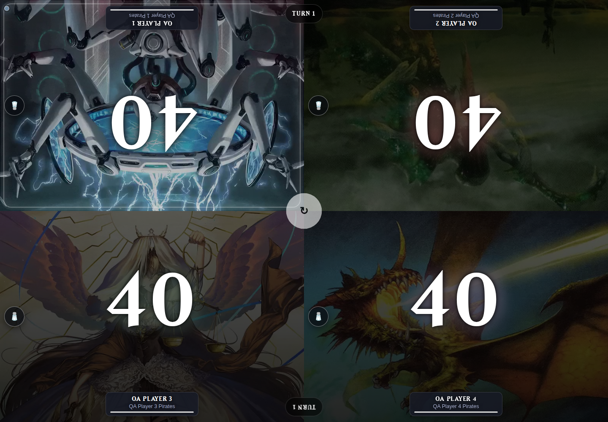

# Commander video art — 2026-10-22

Implemented H.264 MP4 commander art with JPEG posters and automatic conversion of
uploaded GIFs. Commander uploads accept 30 MiB files; animations are limited to
60 seconds and 4096 × 4096 input pixels. Encodes are silent, fast-start, yuv420p,
at most 1280 pixels on the longest edge and 30 fps. Card/profile uploads remain
images with a 15 MiB file limit.

Web lists use still posters. Deck banners play when visible. The life counter
loads and plays only the active seat's video, pauses previous seats on turn
changes, and pauses for page visibility and reduced-motion preferences. The
editor provides a manual video preview. A poster remains usable when autoplay
is blocked or playback fails.

Legacy image URLs remain valid. Existing GIFs are retained byte-for-byte, and
new MP4 uploads use a JPEG for their legacy `url`. Additive API video fields are
available for future native client support; this change does not add MP4
playback to the separately maintained Android app.

## Verification

- 148 distinct automated tests passed across media uploads, real FFmpeg
  conversion, profile pictures, entity APIs, game state/history, life-counter
  parity, deck brackets, browsing, player selection, and UI context. The broader
  run passed 147 tests plus 46 subtests; a subsequent 10-test media run included
  the additional exact-30-MiB multipart boundary test.
- MIME types, H.264/yuv420p encoding, no audio stream, HTTP range requests,
  invalid-file rejection, authorization, duration/dimension/size limits,
  conversion failure, local/object-storage variants, shared-file cleanup, and
  repeatable non-destructive legacy conversion were checked.
- Chromium reached the app at `http://localhost:5066`, bound to `0.0.0.0:5066`.
  Initial sandbox restrictions prevented socket binding/browser startup;
  authorized execution outside that restriction resolved both. No port mismatch.
- Used an isolated copy of the existing browser QA fixture. Four distinct QA
  players each have two populated, real decklists from the earlier import setup.
  Navigated Players, Deck Editor, and `/play_game`, selected four player/deck
  pairs, and started a live game with four life totals of 40.
- Uploaded both GIFs and MP4s, verified a deck banner plays, and verified only
  one life-counter video initially had a `src` and was playing. Clicking the turn
  control paused the old video and started the next. Reduced-motion and document
  visibility changes paused/resumed playback. MP4 upload and save also passed
  through the actual editor file input. An aborted video request correctly kept
  the poster visible. No browser JavaScript errors.
- Captured 1440 × 1000 and 390 × 844 running-game screenshots. External Scryfall
  art and bracket requests were stubbed during browser QA; media requests and
  game mutations used the real local app.
- Python compilation, JavaScript syntax, and `git diff --check` passed.

## Legacy assets and deployment

Both existing databases referenced the same 14 commander GIFs. Conversion was
verified on copies first, then 28 derivative assets and 14 metadata records were
installed in `/home/slemme/mine/commander-tracker/data/art`, the shared art volume.
All original GIF checksums were verified before and after installation. No deck,
player, or game database references were changed.

Total original GIF bytes: **149,398,956**. MP4 bytes: **25,914,862**, an **82.7%**
reduction in animation transfer size. Originals remain on disk, so this is not a
storage-space reduction. Detailed results are in
[legacy-conversion.json](commander-video/legacy-conversion.json).

The updated app/container was deployed to **Test on 2026-10-22 at 21:14 UTC**
with the expanded-filter port; see [deployment checks](test-expanded-filters.md).
Production still uses its previous code. The Dockerfile now installs FFmpeg.
Ensure any reverse proxy accepts the 31 MiB
request ceiling. Preserve `video_metadata/` with the art volume when backing up
or moving the app, including installations using object storage.

To convert newly discovered legacy GIFs after deployment:

```sh
python scripts/convert_commander_gifs.py --dry-run
python scripts/convert_commander_gifs.py
```

The app's normal database/art/object-storage environment selects the source.
External URLs are reported as skipped; upload those files to convert them.



[Mobile game](commander-video/running-game-mobile.png) ·
[Deck banner](commander-video/deck-video.png) ·
[Editor](commander-video/editor-video.png) ·
[Browser results](commander-video/validation.json)
