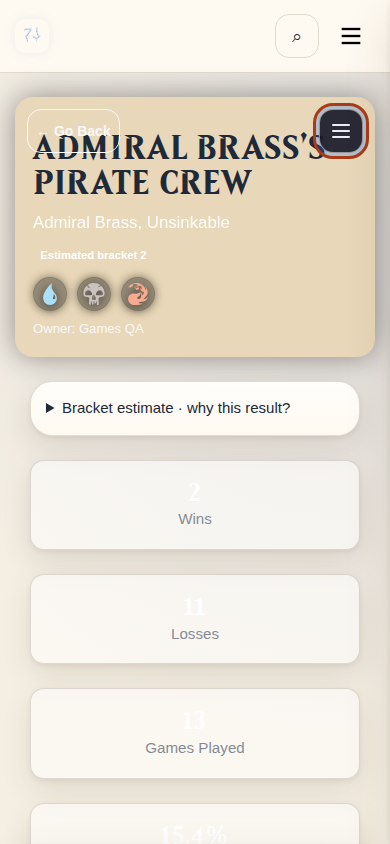

# Deck Go Back button — 2026-10-23

The commander-media rule `.deck-banner > :not(.commander-motion)` overrode the toolbar's less-specific stacking rule. The toolbar and banner text both received z-index 1, and the later text layer intercepted clicks. `.deck-banner > .banner-topbar` now preserves z-index 2. The deck stylesheet URL uses `v=back-button-2` to bypass an older PWA/browser cache entry.

Chromium reproduced the old interception using Test's served CSS, then verified normal Go Back clicks, exact return URLs, and the actions menu in dark/light themes at 1440, 390, and 320px. [Results](validation.json).

Applied a narrow hotfix to the running `commander-tracker-test` container at 08:18 UTC: only the selector/comment and stylesheet version changed. Source files in this workspace also contain the fix for subsequent builds. The Games redesign and other pending changes were not deployed. Test health returned `status: ok` and `database: reachable`; served CSS and container template hashes matched the prepared patch. Production's image and start time were unchanged. This hotfix updates the running container, so any future container recreation should use a build containing the workspace fix.

