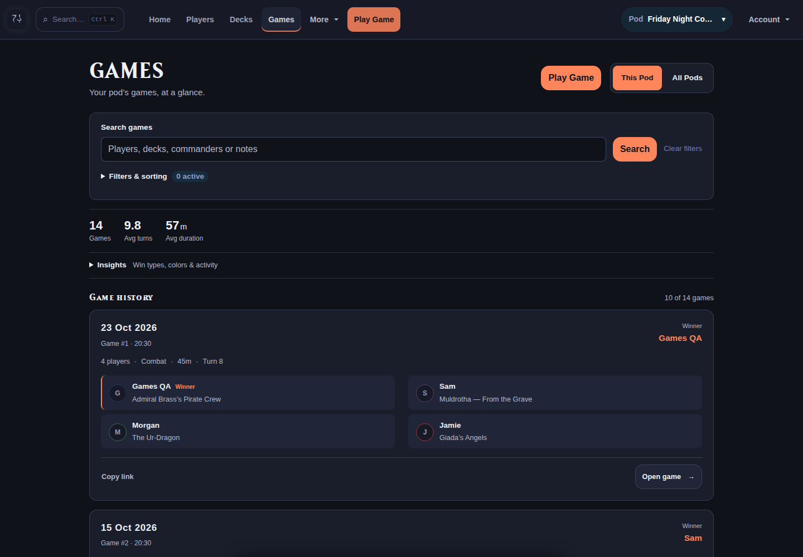
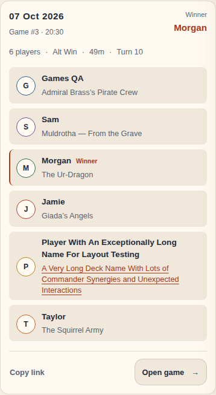
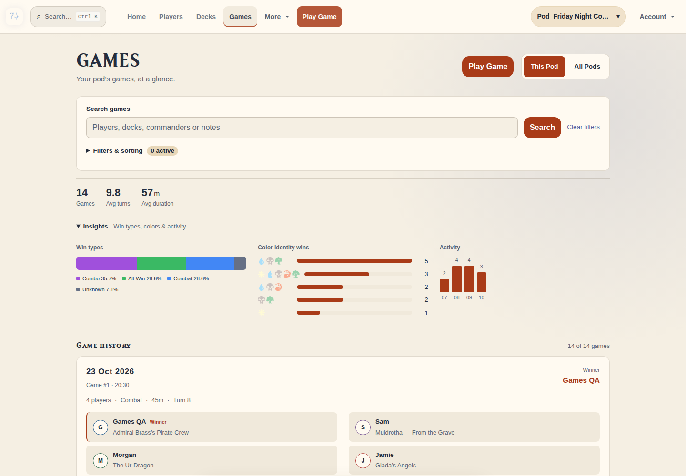

# Games page overhaul — 2026-10-23

Games now use static match cards with every participant and deck visible, a winner highlight, recorded match metadata, and direct Open game / Copy link actions. Search stays visible; advanced filters and Insights remain collapsed until requested. Existing filter URLs, sorting, pagination, pod permissions, and filtered-list return navigation are preserved.

The change is limited to Games presentation and a Games-specific branch in the shared browse controls. Two existing deck-detail issues discovered while following the new cards were corrected: undated history no longer raises a template error, and the banner content no longer intercepts the Go Back button. The existing activity chart's JSON attribute is now correctly quoted so its bars render.

## Verification

- 26 browsing/navigation tests and 117 subtests passed against an isolated SQLite database; `git diff --check` passed.
- Chromium exercised 18 layouts: dark/light themes, 1440/390/320px widths, and collapsed/Insights/filter states. No horizontal overflow or JavaScript errors.
- Verified three-, four-, and six-player games, long names, missing dates and participant records, no matching results, and an empty pod.
- Verified search, filter validation/recovery, chip removal, clearing, pagination, scope changes, native keyboard disclosures, clipboard success/fallback, game/deck navigation, and exact return URLs. Activity bars were explicitly checked after expanding Insights.
- The QA server bound to `0.0.0.0:5071` and Chromium reached `http://localhost:5071`. Synthetic users, decks, and games were stored only in `/tmp/games-overhaul-browser.db`; tests used a separate temporary database. Artwork/analysis endpoints were stubbed during browser checks.
- No live-game UI changed. No production/Test database records were modified, and no deployment was performed.

[Validation results](validation.json)

