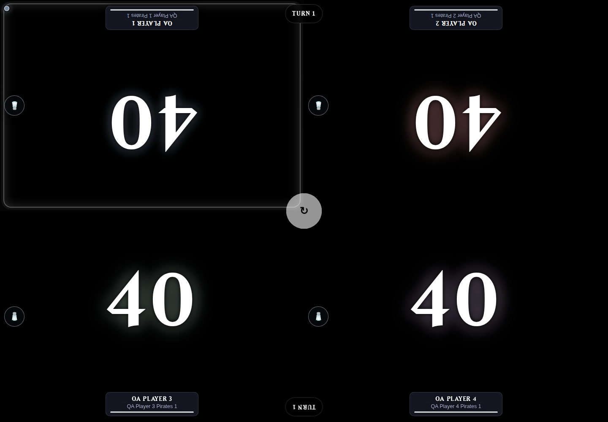

# Tracker reconciliation — 2026-10-27

The production checkout contained uncommitted Android API, native timer, migration,
and player-recency changes missing from test. Both checkouts also held matching
uncommitted web UI/media changes and separate QA artifacts. Production had three
additional committed APK releases, ending at Android 2.4.0.0 (versionCode 66).

The test branch was fast-forwarded from 119391b to production's 41d3adb before
adding the reviewed backend differences. Matching web changes and both sets of QA
artifacts were preserved. All application development now has a committed test
baseline for promotion. Repository workflow instructions cover all three projects.

Validation used a freshly rebuilt `commander-tracker-commander-tracker-test` image:

- `python -m unittest discover -s tests`: **422 tests passed**, 45.367 seconds.
- Unit tests ran with networking disabled, an ephemeral `/data`, an explicit
  temporary SQLite URI, and no host database mounts.
- A separate QA container bound to `0.0.0.0:5000`, exposed at `localhost:5097`.
- Four active QA players each had two decks from the canonical Archidekt import
  (`https://archidekt.com/decks/10697552/pirates_unmodified`); import succeeded.
- Browser navigation verified Players and Decks, selected four distinct player/deck
  assignments through `/play_game`, and started a game at 40 life per player.
- Desktop and mobile screenshots show the running game. Browser page errors: zero.
- Android browse endpoints, player-recency fields, and a four-player native chess
  clock game passed live HTTP checks against the isolated QA server.
- Android's generated release manifest matches the server manifest exactly; the
  versioned 2.4.0.0 APK matches its declared SHA-256.
- `git diff --check` passed before committing.

Original dirty files and binary patches were archived before reconciliation.
Consistent online backups of both live SQLite databases were taken before service
recreation; both backup integrity checks returned `ok`. No live database was used
for test fixtures or automated test execution.

