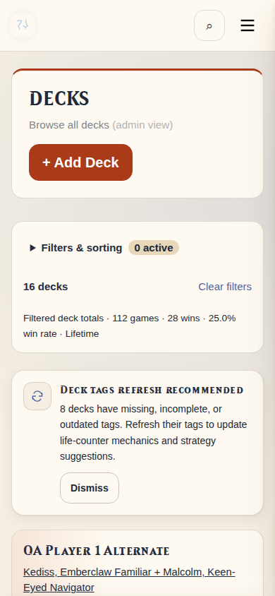
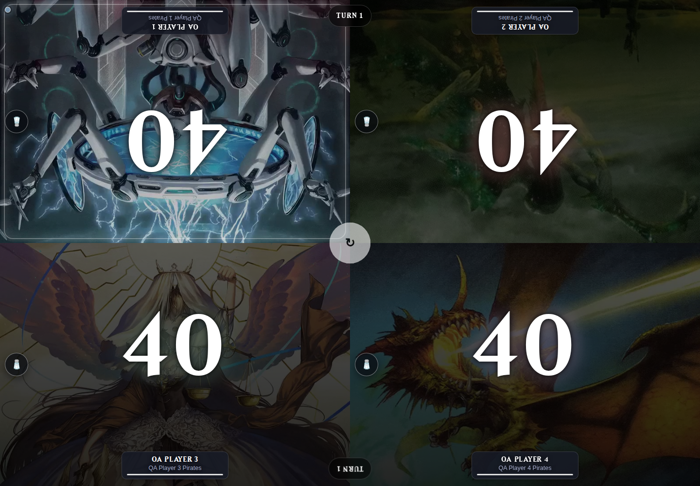

# Expanded filters on Test — 2026-10-22

Ported the production workspace's expanded browsing implementation into Test,
preserving Test's existing navigation refinements and commander video support.
This includes the production filtering/query helpers, deterministic sorting,
pagination, period-aware statistics, multi-value filters, filter chips, bounded
detail queries, and safe return navigation through detail/editor pages.

Decks, Players, and Games now put **all** filter/search/sort controls inside one
native “Filters & sorting” disclosure. It is closed initially and after applying
valid filters. Applied values are retained; removable chips and result totals
stay visible outside the disclosure. Invalid filters automatically open it for
correction. Enter/Space can operate the disclosure without custom JavaScript.

## Verification

- Full suite: **418 passed, 203 subtests passed**. Only the expected temporary
  test Flask-secret warning. Tests use isolated databases and temporary art.
- Browser: **36 layouts**, covering all three listings, two themes, widths 1440,
  390, and 320, and both expanded/collapsed states. No horizontal overflow or
  JavaScript errors.
- Checked explicit Apply, multiple bracket selections, chip removal, clearing,
  pagination, detail return URLs, custom-date/preset switching, error recovery,
  and preservation of game filters across scope changes.
- The QA app bound to `0.0.0.0:5068` and Chromium reached
  `http://localhost:5068`. Used a copy of the existing synthetic QA fixture:
  four named QA players, each with two populated imported decklists. Navigated
  through game setup to a running four-player session, all life totals 40, and
  verified only one commander video was playing. The browsing stylesheet is
  excluded from the life counter. External card-art/bracket lookups were stubbed
  in browser QA; filtering, uploads already present, and game state used real
  app routes. No production or Test fixtures were added.
- Python compilation, JavaScript syntax, and `git diff --check` passed.

## Deployment

Deployed **only `commander-tracker-test`** at **2026-10-22 21:14 UTC** using the
Test workspace as the explicit Compose build context. This also deploys the
previously verified video-art changes and FFmpeg dependency.

Test image: `sha256:73508f6ffa576d91550d65b2434a751202de1b97b375c90f64bfa00bc742801d`.

- `http://localhost:5001/healthz` returned HTTP 200 with database reachable.
- Authenticated read-only checks against the deployed code passed all three
  listings, combined filters, and invalid-filter disclosure behavior.
- All **18 checked source/template/style hashes** match the verified workspace.
- All 14 legacy commander GIFs resolve to MP4/poster variants, video byte-range
  delivery returns HTTP 206, and an actual FFmpeg conversion passed inside the
  new container. Player/deck/game record counts were unchanged by smoke checks.
- Production image and start time remained unchanged:
  `sha256:7b6dac638512657b77bc91ce18720c54e5b0c2b9761d58718ac9ae236498c56f`,
  started `2026-10-22T14:13:09.756843197Z`.
- No commit or push was made. The two workspaces had existing uncommitted work;
  the port was merged at the file level and preserves the pending Test changes.

[Browser results](test-expanded-filters/validation.json) ·
[Deployment checks](test-expanded-filters/deployment.json) ·
[Expanded desktop filters](test-expanded-filters/decks-dark-1440-expanded.png)

